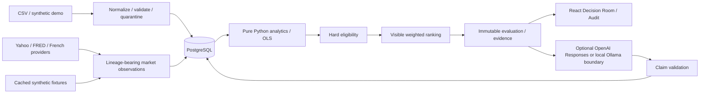

# Architecture

Backend modules: ingestion, analytics, mandates, providers, evidence, ai, service, models and API. Three Compose services; no background infrastructure. Raw uploads are stored with SHA-256 and source-row lineage. Each run persists mandate, metrics, evaluations and evidence atomically. Market refresh is explicit and independent of ingestion. Provider exceptions fall back per source, with reason and synthetic status surfaced.

JSONB stores flexible metadata, constraint reasons, score components and structured claims; relational keys own identity and uniqueness. A run UUID scopes immutable evidence, avoiding evidence overwritten by subsequent evaluations. Frontend receives computed chart series and never calculates financial metrics.

Touched surfaces: relational schema, migration, Pydantic contracts, finance formulas, provider status, evaluation persistence, UI units/refresh, optional AI, CSV upload, test fixtures and documentation. There is no prior host code or compatibility surface.
