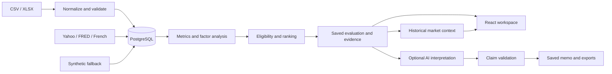

# Architecture

## Data flow

## Main decisions

- **React and TypeScript:** typed UI contracts, charts and a guided research workflow. The frontend displays backend results rather than calculating finance.
- **FastAPI and pandas/NumPy:** explicit, testable monthly-return calculations and regressions, separate from HTTP and AI.
- **PostgreSQL:** relational identity, uniqueness and transaction guarantees, with JSONB for evaluation snapshots and evidence metadata. Compose supplies the database for both startup and tests.
- **Eligibility before ranking:** hard breaches exclude managers before scores are assigned. Missing critical risk measurements fail closed. Fixed bounded score transforms and visible profile weights make ranking policy inspectable.
- **Evaluation-scoped evidence:** memo claims retain the mandate, calculation methods, input coverage and source references from their saved run. Subsequent changes do not overwrite those references.
- **Optional AI:** Ollama uses structured local output; OpenAI uses Responses API structured output. Both pass application validators. AI does not calculate metrics or decide eligibility and rank.

Raw uploads retain their original bytes, SHA-256 digest, mappings, corrections and row lineage. Duplicates do not double-count returns. Missing months are not imputed; affected metrics and coverage limitations are surfaced.

Public retrieval is explicit. Each failed source uses an explicitly labeled synthetic fallback. AI or market-provider failure preserves the evaluation and available briefing.

Market trends are computed on demand from a run’s saved benchmark and macro evidence, without retrieving new data or changing that run. Period returns require complete consecutive 3- or 12-month windows; annualized volatility uses 12 monthly returns. The chart compounds a starting index of 100. Macro changes require adjacent months and show each series’ own date and source status.

`GET /api/runs/{run_id}/market-context` also works for existing saved evaluations. The panel loads independently, so a failed request leaves the rest of the workspace usable and offers a retry.

## Code map

| Area | Files |
| --- | --- |
| API and orchestration | `backend/app/main.py`, `service.py` |
| Imports and validation | `backend/app/ingestion.py`, `imports.py` |
| Metrics and factor regressions | `backend/app/analytics.py` |
| Saved market trends | `backend/app/market_context.py`, `frontend/src/MarketContext.tsx` |
| Mandate rules and scores | `backend/app/mandates.py` |
| Public providers and synthetic fixtures | `backend/app/providers.py`, `demo.py` |
| Evidence, AI and exports | `backend/app/evidence.py`, `ai.py`, `exports.py` |
| Database and migrations | `backend/app/models.py`, `backend/alembic/` |
| Workspace and import UI | `frontend/src/App.tsx`, `ImportWizard.tsx` |

## Validation and verification

Import checks cover required values, units, dates, duplicate observations, identity conflicts, history gaps and inconsistent ranges. Analytics use exact-month alignment and guard against insufficient observations, missing inputs and invalid denominators.

AI checks reject unknown funds, invalid or cross-fund citations, invalid recommendations and unsupported quantitative prose. Software renders quantitative claims directly; model interpretations and source notes still require human review. A valid citation does not establish semantic correctness.

Recorded verification includes 40 passing PostgreSQL-backed tests and frontend lint/type/build checks on October 12, 2026. Actual local Qwen memo and challenge generation, persistence and citation ownership were verified on October 11. The live OpenAI path was not verified successfully because API credit was exhausted. Tests use mocked inference; they do not replace actual-provider acceptance. See [SETUP.md](SETUP.md) for reproduction commands.

## Limitations

- Bundled manager and startup market data are synthetic. Public refresh may mix live observations and synthetic fallbacks.
- Liquidity represents redemption frequency, not notice periods, gates, settlement or lockups.
- Scores reflect configurable policy, not portfolio optimization or an allocation decision. Short histories, omitted factors and conventional OLS errors limit interpretation.
- No FX conversion, gross/net reconstruction, serial-correlation adjustment or survivorship-bias correction.
- Market and AI calls are synchronous. There is no historical-run selector, background job queue or scheduled refresh.
- Word and Excel exports are static snapshots. Browser printing supplies PDF output; page length varies.
- Authentication, permissions, concurrency and tamper-resistant audit storage are not production hardened.
