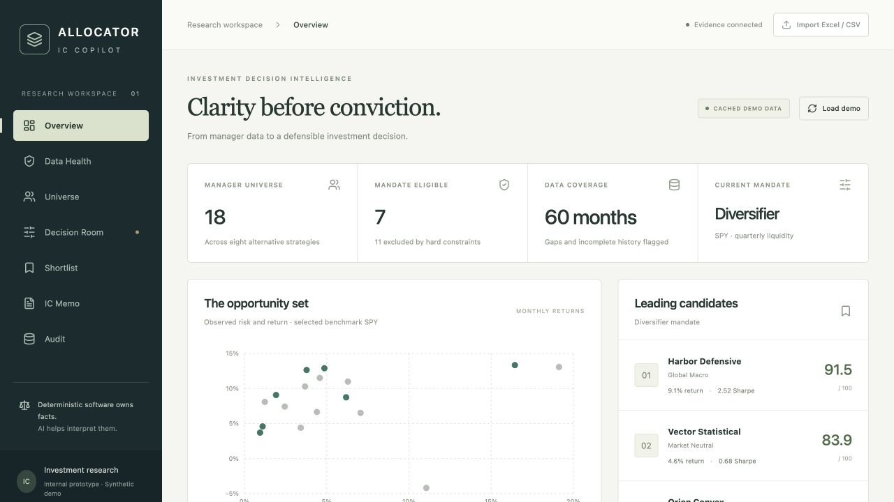
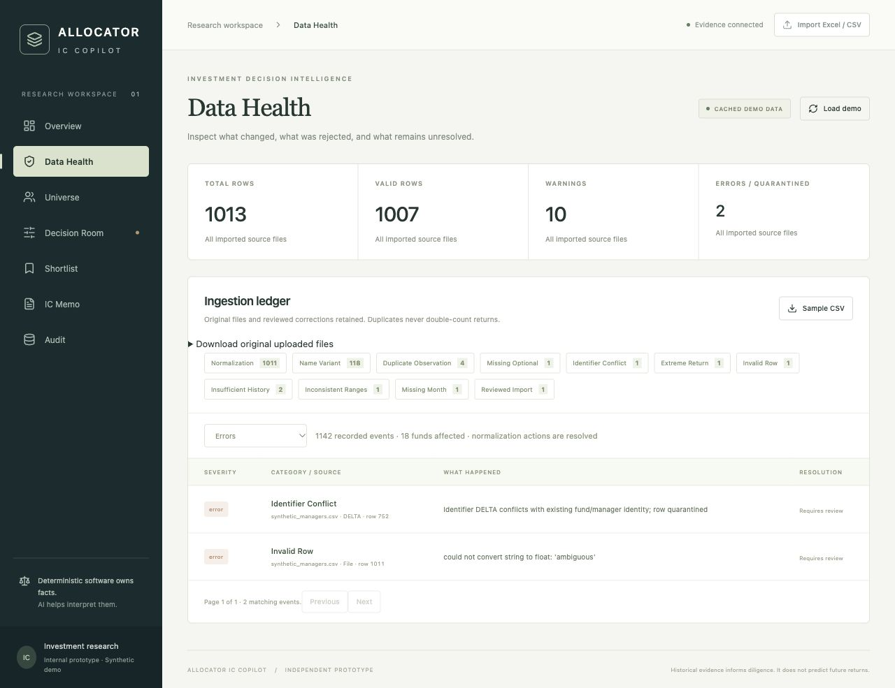
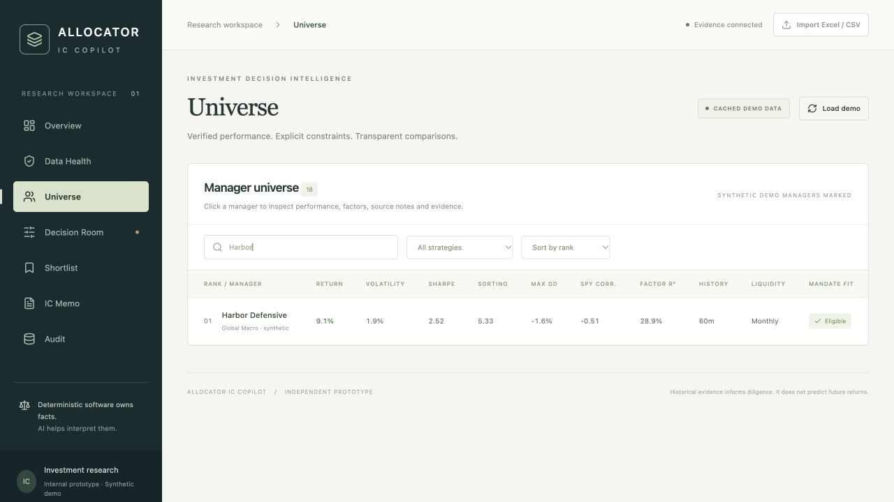
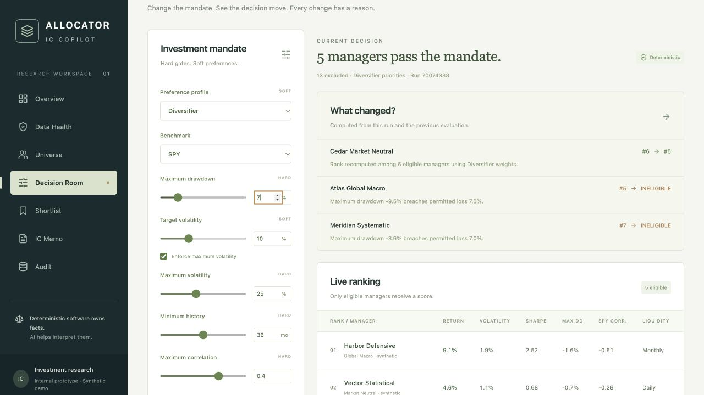
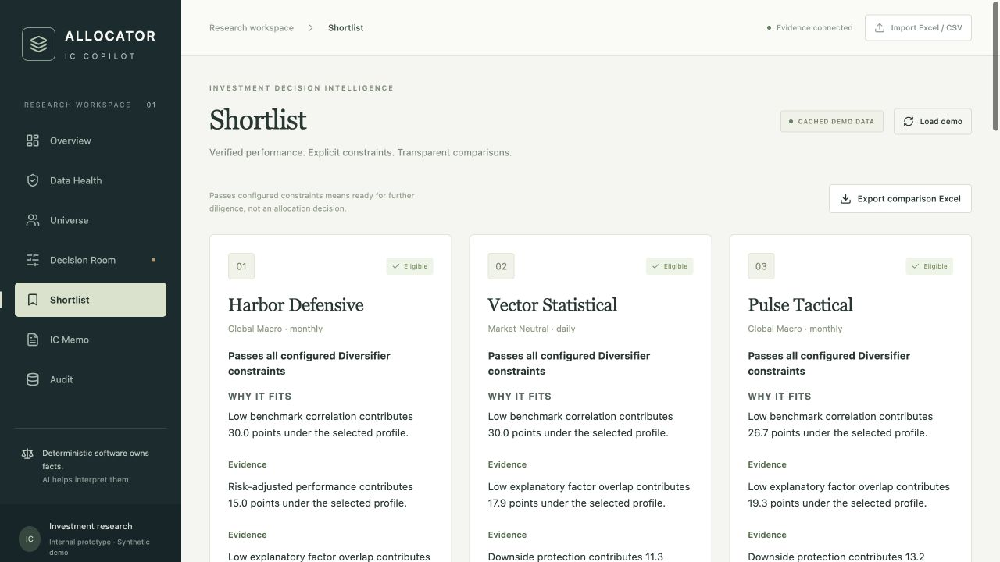
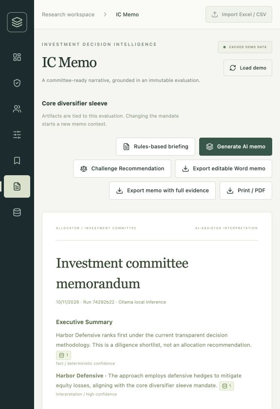
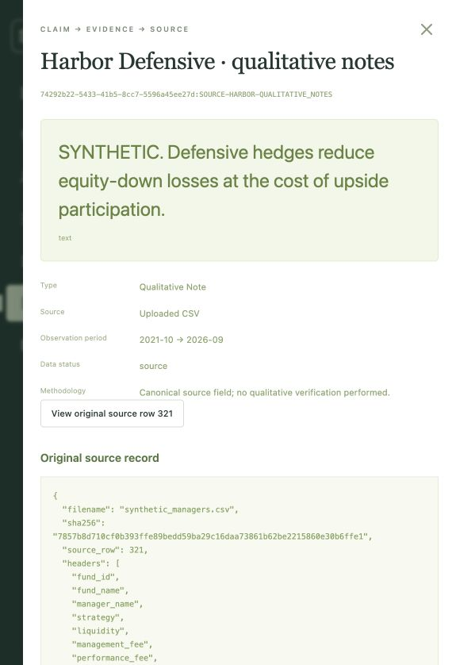

# Presenting Allocator IC Copilot

Updated October 12, 2026. This guide compares the implementation with Option B: Allocator Memo Builder (IC Draft + Audit Trail). It reflects source inspection and the actual October 11 local-model acceptance recorded in REVIEW.md. Public market providers were not rechecked for this guide.

This document owns the presentation narrative and timed walkthrough. Use [SETUP.md](SETUP.md) to install, configure and verify the app beforehand; [README.md](README.md) explains the product and architecture.

## Start with the problem

An allocator selects investment managers. An investment committee (IC) reviews the proposed decision. A mandate is the set of constraints that the selection must satisfy.

Use this opening:

> An allocator receives manager spreadsheets with inconsistent names, return formats and missing months. Before recommending anyone, they need to clean the data, compare performance with a benchmark, apply their investment constraints, and explain their decision to a committee. Allocator IC Copilot connects those steps and lets a reviewer trace memo claims back to calculations or original source fields.

The value is less manual reconciliation, clearer reasons for exclusions, and faster verification of the resulting draft. We have not measured time savings or conducted a finance-user usability study.

## Prepare the demonstration

1. Start the app and, for actual AI generation, its local model using [SETUP.md](SETUP.md). Keep the model running and rehearse generation time before presenting.
2. Use **Load demo** and inspect Data Health/source status. A clean seeded universe contains 18 managers and 1,007 accepted observations. Uploaded files and previous runs are retained, so additional imported managers can change the demonstration counts.
3. Confirm the baseline mandate: **Diversifier**, **SPY**, **quarterly liquidity**, **15% drawdown tolerance**, **10% target volatility**, **25% maximum volatility**, **36 months minimum history**, **maximum benchmark correlation 0.40**, and no strategy exclusions.
4. Rehearse the change to **7% drawdown**, then **monthly liquidity**. The documented synthetic universe moves from **7 → 5 → 4** eligible managers. Atlas fails the tighter drawdown gate at approximately −9.5%; Orion fails monthly liquidity. The leader need not change: the eligible candidate set does.
5. Decide whether to demonstrate synthetic fixtures or a public-data refresh. Refreshing changes market inputs and can change rankings/eligibility; do not promise the synthetic baseline counts after refreshing. If showing both, finish the deterministic walkthrough first, then refresh and state the actual per-source status.

## Five-minute recording walkthrough

Record one story: messy manager data → validated history → mandate fit → shortlist → committee memo → source verification. Use the steps below in order. Screenshots of the first six stages were captured October 12; the AI screenshots are labeled references from the verified October 11 acceptance.

### Before pressing Record

- Open the app in a wide browser window and keep the navigation visible. Close unrelated tabs and notifications.
- Follow SETUP.md to start local Ollama. Rehearse one generation to confirm it works, then reset the mandate before filming.
- On Decision Room, click **Reset demo mandate**. Confirm seven eligible managers and the baseline above, then return to **Overview**.
- Have `data/synthetic_managers.csv` ready if showing the import preview. It is already loaded in the seeded app; reimporting it demonstrates duplicate handling, not a new universe.
- Generate the memo **after the final mandate change during the recording session**. Pause recording or cut the generation wait. Changing constraints creates a new evaluation, so a memo prepared before the changes will not automatically appear for the final run.
- Do not run public refresh during the fixed 7 → 5 → 4 sequence. The current recording uses clearly labeled synthetic market fixtures. A separately recorded refresh can demonstrate public retrieval; show its actual live/fallback status and label that clip as a separate evaluation.

### 1. Overview — 0:00 to 0:25

**Click:** Overview in the left navigation.

**Point to:** 18 managers, seven mandate-eligible managers, and the cached demo data badge.

**Say:**

> This is Allocator IC Copilot. An allocator selects investment managers, and an investment committee reviews the proposed decision. I built this to connect messy manager data, investment constraints and an auditable committee draft. The bundled manager histories and startup market inputs are synthetic, so this is a demonstration of the workflow.

**What the viewer should understand:** the user, the problem and the end result.

### 2. Input review and Data Health — 0:25 to 1:10

**Click:** If showing upload, click **Import Excel / CSV**, select the sample CSV, and briefly point to **Match your columns**, **Review and correct values** and **Update preview**. Close with **Close import**; do not confirm a duplicate sample just for the recording. Then click **Data Health**.

**Click:** Choose **Errors** in the **Issue severity** dropdown. Scroll to the two error rows. Point to the DELTA identifier conflict and invalid return row. If time allows, click **Missing Month** to show Aurora's history gap, then proceed.

**Say:**

> A manager spreadsheet needs review before analysis. The import screen checks column mappings and values before anything is saved. Data Health retains the original source and records each normalization, warning and rejected row. Here, the same identifier refers to conflicting identities, so the row is quarantined. Invalid returns are rejected, and missing months are never filled with invented performance.

**What the viewer should understand:** validation protects calculations and preserves provenance. The sample is already imported; preview duplicates are expected.

The current screenshots show 1,013 total source rows because an earlier three-row review upload is retained. Accepted observations remain 1,007 across 18 managers. A clean bundled seed has 1,010 source rows. Avoid reading an unrelated total into the narration.

### 3. Historical comparison — 1:10 to 1:45

**Click:** Universe, then type **Harbor** into **Search managers**. Point to return, volatility, Sharpe, maximum drawdown and SPY correlation. Click the Harbor row only if you want its deeper charts; close the manager drawer before continuing.

**Say:**

> Python computes these metrics from monthly return histories. In this synthetic example, Harbor has approximately nine percent annualized return, low observed volatility and a small historical drawdown. Sharpe measures excess return relative to variability; benchmark correlation measures co-movement with SPY. The app can pull public benchmark data, and always identifies whether this evaluation uses live observations or synthetic fixtures.

**What the viewer should understand:** comparable metrics come from software and aligned histories, with explicit source status. They are historical descriptions, not predictions.

### 4. Drawdown constraint — 1:45 to 2:20

**Click:** Decision Room. Point to the seven-manager count and hard versus soft controls. In the numeric box labeled **Maximum drawdown value**, replace **15** with **7**. Wait for **5 managers pass the mandate**; no Apply button is needed.

**Point to:** **What changed?** Atlas and Meridian become ineligible. Atlas's observed loss is about 9.5%, above the permitted 7%.

**Say:**

> A mandate describes what the allocator can accept. Hard constraints determine eligibility before any scoring. I am reducing the permitted historical drawdown from fifteen to seven percent. Atlas and Meridian now fail that requirement, and the eligible set falls from seven to five. The app shows the specific reason rather than hiding it in a new score.

**What the viewer should understand:** good performance cannot compensate for a failed hard constraint.

### 5. Liquidity constraint — 2:20 to 2:45

**Click:** Scroll the mandate controls to **Liquidity requirement**. Select **monthly** instead of **quarterly**. Wait for **4 managers pass the mandate**.

**Point to:** Orion Convex's **INELIGIBLE** change and **Quarterly liquidity fails monthly requirement**.

**Say:**

> Next, this allocator needs monthly liquidity. Orion's quarterly redemption frequency no longer fits, so it leaves the eligible set. We now have four candidates. The leader can remain unchanged; the important result is that every candidate still on the shortlist satisfies the configured requirements.

### 6. Explain the shortlist — 2:45 to 3:15

**Click:** Shortlist. Use Harbor's card and point to **Why it fits**, **Concerns to review**, and the score contributions. Briefly point to **Export comparison Excel** without opening another application.

**Say:**

> The shortlist leads with suitability explanations rather than just a score. Harbor's low benchmark correlation and risk-adjusted performance contribute under the selected Diversifier policy. The score is based on visible weights, not an AI opinion. The manager's source note still raises a tradeoff: defensive hedging can reduce upside participation. That concern remains visible for diligence.

### 7. Memo and claim verification — 3:15 to 4:25

**Click:** IC Memo → **Generate AI memo**. Pause recording while it generates, or cut the wait. Once saved, click **Challenge Recommendation** and similarly omit waiting time. Resume on the completed memo. Do not change the mandate or press Load demo afterward.

**Point to:** Executive Summary, Recommendation and Key Risks. The provider line should say **Ollama local inference** for local mode, and the artifact should say **AI-assisted interpretation**. If only a rules-based briefing is available, label it accurately and use the curated Word example to discuss the previously verified AI output.

**Say:**

> A local Qwen model adds qualitative rationale and diligence questions around the saved evidence. Software still supplies the numerical facts, eligibility and ranking. The result separates deterministic claims from interpretations. Here is the key review step: instead of trusting a sentence, I can inspect what supports it.

**Click:** A citation next to the defensive-hedging interpretation or Key Risks note → evidence drawer → **View original source row**. The row number appears on the button and can vary; the verified seed's Harbor note is row 321. Show the original qualitative note and source digest. Close the drawer. Scroll to the challenge's diligence questions if time allows.

**Say:**

> This citation opens the saved source field and the original uploaded row. A metric citation instead exposes its value and methodology. The claim remains linked to the evaluation that produced it. The challenge asks what still needs verification, but an evidence link establishes traceability; it does not independently prove a manager note or AI interpretation is true.

Reference images below are from the earlier accepted local AI run, not the newly captured October 12 evaluation.

### 8. Export and close — 4:25 to 5:00

**Click:** **Export editable Word memo**. Show the downloaded filename, or cut to the opened Word document prepared from this same run. Keep **Export memo with full evidence** visible as the longer audit option. Finish on the memo or Overview rather than navigating through every remaining screen.

**Say:**

> The output is an editable committee draft and an Excel comparison snapshot. React handles the workspace, Python owns validation and financial calculations, and PostgreSQL preserves evaluations and evidence. The reviewed AI memo was two pages; longer source content can change pagination. This is a prototype with synthetic managers and human-reviewed interpretations. Its core value is making the decision and its supporting evidence easy to inspect.

**Do not spend recording time on:** terminal setup, the entire audit registry, every manager, every formula, every strategy exclusion or a full code tour. Setup and verification are documented separately. Record small sections with a two-second pause around clicks, and join them in the order above.

## Check against the original assignment

| Original requirement | Assessment | Evidence and qualification |
| --- | --- | --- |
| Web app from a messy fund universe to a defensible IC memo | Implemented core workflow | React workspace connects reviewed import, analytics, mandate, shortlist, memo and audit. Defensibility means visible methods and lineage, not verified investment truth. |
| CSV or a few CSVs with names, strategy, liquidity, fees, returns and notes | Mostly implemented | Monthly long-format CSV is supported; the legacy batch API accepts up to ten CSVs. Reviewed UI import handles one CSV/XLSX at a time. Fees and notes are optional source fields. Summary-stat-only datasets, wide monthly matrices and separate metadata/return-file joins are unsupported. |
| Mandate form with liquidity, target volatility, drawdown and strategies | Implemented with a UI qualification | Liquidity, volatility, drawdown, history, benchmark correlation, profile and strategy exclusions are exposed. Explicit preferred strategies/custom weights are supported by the API; the UI expresses soft preferences through profiles rather than individual preferred-strategy editing. |
| Normalize and validate missing values, date ranges and mismatched identifiers | Implemented | Required-field/format checks, exact ID canonicalization, metadata conflicts, duplicate handling, return/fee units, completed-month checks and history-gap flags. No fuzzy merging or missing-return imputation. Reviewed preview uses the real validator without persisting changes. |
| Pull public benchmark data | Implemented; startup is offline | Yahoo adjusted monthly prices for seven ETF proxies; FRED risk-free proxy/macro series; French explanatory factors. Public refresh is explicit. Earlier verification recorded successful retrieval from all providers. Actual status and synthetic fallback are displayed; availability today was not rechecked for this guide. |
| Drawdown, volatility, Sharpe and benchmark/peer correlation | Implemented | Backend owns financial calculations and exact monthly alignment. Benchmark correlation satisfies the benchmark-or-peers requirement; a peer correlation matrix is not necessary to claim this requirement. Unavailable critical inputs produce null and fail closed where required. |
| Use an LLM to produce a ranked shortlist with rationale | Partial literal match; deliberate architectural choice | Hard gates and weighted scoring determine the shortlist. The LLM must retain the eligible engine leader and cannot rank, calculate or change eligibility. It adds evidence-linked qualitative rationale, risks and diligence questions. Explain this split explicitly rather than claiming LLM-owned ranking. |
| LLM-generated 1–2 page IC memo: summary, recommendation, risks, appendix | Implemented and locally verified for the demo | Actual local-model generation saved 20 memo claims and six challenge claims with validated citations. The compact AI Word memo rendered in two pages; the challenge rendered in one. Full methods are available through a separate full-evidence export. Arbitrary uploaded content and browser printing do not have a universal page-count guarantee. |
| Audit view linking memo claims to metrics or source fields | Implemented with an interpretation limit | Claim IDs resolve to saved evaluation evidence, formulas, periods and source rows. Later evaluations do not rewrite earlier evidence. Citation validity does not prove that every AI interpretation logically follows from its evidence. |

## Explain the technical decisions

- **FastAPI, pandas and NumPy:** financial calculations and data validation live in one backend, which makes them testable and avoids conflicting browser calculations.
- **React and TypeScript:** interactive import review, constraint changes and evidence drilldown, with typed API contracts.
- **PostgreSQL, SQLAlchemy and Alembic:** relational identities and uniqueness checks, flexible snapshot metadata, and versioned schema changes.
- **Deterministic gates before scoring:** an ineligible manager cannot win through a high performance score. Scores use visible fixed scales and weights.
- **Evaluation-scoped evidence:** a memo retains the facts and sources used when it was created, even after another mandate or market refresh.
- **Provider boundaries and explicit fallback:** a public-data outage does not disable the demo or masquerade as live historical data.
- **Bounded structured output through local Ollama or OpenAI:** the model writes interpretations against selected evidence; validators reject unknown funds, invalid citations and unsupported numerical/ranking prose. Local generation uses constrained sections and reversible citation handles; its interpretation scope is source notes, while software supplies quantitative analysis. These restrictions trade expressive freedom for stronger controls, but do not establish semantic correctness.
- **Docker Compose:** reproducible frontend/backend/database startup without extra distributed infrastructure.

## Questions to prepare for

**Is this real fund data?** No. Bundled manager identities, notes and histories are synthetic. Public market data can be fetched live; offline market fixtures are also synthetic.

**Why not let AI choose the winners?** Mandate compliance and quantitative rankings need reproducible rules. AI helps explain and challenge the result, while the user can inspect the inputs and policy.

**Does an evidence link prove a claim is true?** It proves traceability. Source notes still need independent verification, and AI interpretations require human review.

**Is this ready for institutional deployment?** It is a working prototype. Authentication, production concurrency hardening, durable jobs, stronger logging and real-user acceptance remain future work. Simple liquidity frequencies do not represent every notice period, gate or lockup. There is no portfolio-level allocation optimizer.

## Remaining qualifications for the submission

1. Actual local-model memo/challenge acceptance and reviewed Word examples are complete. OpenAI-specific verification remains optional and requires funded access. Qualitative interpretations still need human review; the small local model is not independently validated investment reasoning.
2. The reviewed compact AI memo meets the two-page target; unusually long uploaded notes or other Word/browser renderers can change pagination. Full evidence is deliberately a longer optional export.
3. Document the deterministic-ranking/LLM-rationale split as an explicit interpretation of the brief; seek clarification only if the evaluator requires LLM-owned ranking.
4. Treat summary-stat-only ingestion and richer UI strategy preferences as remaining input/UI scope, not features already delivered.

Supporting documents: [README.md](README.md), [SETUP.md](SETUP.md), [DATA_SOURCES.md](DATA_SOURCES.md), [ARCHITECTURE.md](ARCHITECTURE.md), [REVIEW.md](REVIEW.md).
