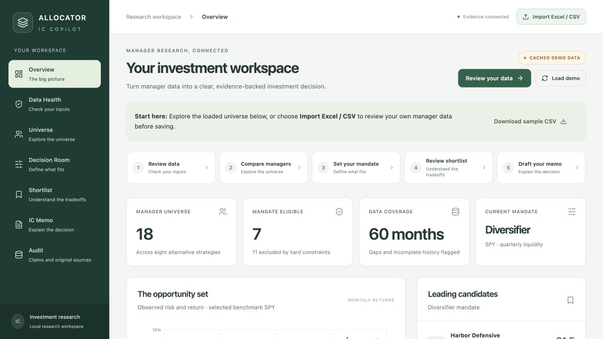
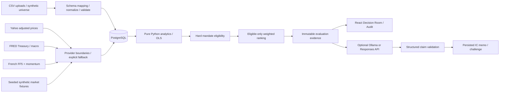

# Allocator IC Copilot

An allocator’s investment decision workspace: messy manager CSVs become validated monthly histories, deterministic analytics, hard mandate decisions, transparent rankings and evidence-backed committee material.

**Deterministic software owns facts. AI helps interpret them.**

This is an independent prototype. All bundled manager histories, identities and notes are synthetic.

## Quick Start

With Docker Desktop running:

```sh
git clone https://github.com/abhishekreddy1206/allocator-ic-copilot.git
cd allocator-ic-copilot
[ -f .env ] || cp .env.example .env
docker compose up --build -d
```

Open [http://localhost:5173](http://localhost:5173). The database migrates and the synthetic dataset seeds automatically. No API key is required for analytics, ranking, evidence, or the rules-based briefing.

Local AI is available through Ollama with `qwen2.5:3b-instruct-q4_K_M`; OpenAI remains an optional hosted provider. AI provider selection and public market refresh are separate. The verified October 11 run used actual local inference with synthetic manager and market inputs.

Detailed installation, provider configuration, verification commands and troubleshooting: [SETUP.md](SETUP.md). Guided walkthrough and presentation script: [PRESENTATION_GUIDE.md](PRESENTATION_GUIDE.md).



## Workflow for Finance Users

**Import Excel / CSV** opens a review dialog before saving anything. Select an XLSX worksheet, match your column headers, inspect validation results, and correct cells. Update the preview after each edit, then confirm the import. The first 200 rows are editable in the UI; validation covers all rows, up to 50,000. Issue previews prioritize errors and warnings and show up to 300 events; Data Health holds the full ledger after import. Headers must be in row one and monthly observations must use long format.

XLSX date cells and percentage-formatted numbers are recognized. Workbook formulas are never evaluated or accepted as cached results; replace them with verified values before importing. Legacy XLS, macro-enabled files, merged header layouts, and wide monthly matrices are not supported. Original file bytes, source digest, chosen sheet, column mapping, and corrections are retained. Data Health lets you download the original files. Evidence source records show original values alongside reviewed corrections. Import identities include the review configuration; reimporting the identical reviewed version is idempotent. Corrections can rescue rejected rows, but cannot overwrite existing accepted monthly returns.

**Shortlist** and manager details lead with a deterministic suitability explanation: configured constraints passed or failed, the largest score contributions, unverified source concerns, unavailable analyses, and unresolved data warnings/errors. Routine resolved normalization events are excluded from the action list. These explanations describe the configured policy; they do not establish investment suitability for a real portfolio. Older saved runs remain unchanged; reevaluate to add the explanation to a new snapshot.

**Export comparison Excel** downloads all managers from the saved evaluation with numeric return/risk values, eligibility, rank, score, history windows, exclusion reasons, concerns, and decision evidence IDs. Filters and frozen panes support review. **Export editable Word memo** downloads the displayed saved memo, or a deterministic briefing if none exists, with compact numbered evidence references. **Export memo with full evidence** adds detailed methods and source records after a page break. Exports are static snapshots; editing them does not update the app. Neither export calls AI or recalculates finance. Page length depends on saved content and the Word renderer; verified page counts are recorded in REVIEW.md.

## Why I Built It This Way

The interesting product problem is deciding which manager belongs in a particular sleeve, and explaining why that decision changes. A generic financial chatbot obscures constraints, data problems and calculation assumptions. This product makes those visible before introducing prose generation.

A manager with strong returns can fail liquidity. A lower-return manager can be a better diversifier. A performance gap can prevent a defensible risk assessment. Those are explicit decisions, not LLM opinions.

The minimum useful system is one Python backend, one React frontend and PostgreSQL. Small functions own compounding, regressions, hard gates and scores. Each evaluation snapshots its evidence; a memo from an earlier mandate remains auditable after the next run.

## Architecture



See [ARCHITECTURE.md](ARCHITECTURE.md), [PROJECT_SPEC.md](PROJECT_SPEC.md), [IMPLEMENTATION_PLAN.md](IMPLEMENTATION_PLAN.md) and [DESIGN_DECISIONS.md](DESIGN_DECISIONS.md).

| Concern | Implementation |
| --- | --- |
| Financial formulas, alignment, drawdown | `backend/app/analytics.py` |
| Hard eligibility and weighted scores | `backend/app/mandates.py` |
| CSV normalization, canonicalization, quarantine | `backend/app/ingestion.py` |
| Yahoo, FRED, French and cached providers | `backend/app/providers.py` |
| Source lineage and deterministic briefing | `backend/app/evidence.py` |
| Prompt/input construction and claim validator | `backend/app/ai.py`, `backend/app/main.py:create_memo` |
| Transactional evaluation orchestration | `backend/app/service.py` |
| ORM and frozen initial SQL migration | `backend/app/models.py`, `backend/alembic/versions/` |
| UI contracts and formatting | `frontend/src/types.ts`, `frontend/src/api.ts` |

PostgreSQL persists raw uploads and digests, funds, monthly observations, issues, benchmarks, factors, macro observations, mandates, immutable runs, metric snapshots, factor exposures, evaluations, evidence, memos and claims. Unique constraints protect fund-period, benchmark-period, factor-period and macro-period identities. JSONB contains flexible calculation and score metadata. Financial units are decimal fractions throughout the backend; only presentation converts to percent.

## System Data Flow

1. Import one CSV/XLSX through the reviewed UI; the legacy batch API accepts up to ten UTF-8 CSVs. Each file is limited to 8 MB and 50,000 rows.
2. Map supported column aliases, normalize exact identifiers/case/strategy/date/units and retain original CSV bytes as decoded text plus SHA-256.
3. Record every normalization and issue. Quarantine invalid rows, conflicting identities/metadata and conflicting observations. Identical duplicate observations are excluded. No fuzzy identity merge or zero-return imputation.
4. Persist canonical funds and observations atomically. A malformed file header rolls back that upload batch. Row-level failures leave valid observations usable.
5. Join histories by exact calendar month with market/RF/factor inputs. Never forward fill or substitute another month.
6. Compute finance, explanatory OLS, correlations and a small regime view in Python.
7. Apply hard gates; score only eligible managers with visible preferences and fixed scales.
8. Snapshot source values, methods and observations into evaluation-scoped evidence. Evaluation reads use PostgreSQL repeatable-read isolation.
9. Show structured differences from the previous evaluation. Memo context refreshes when a run changes. Artifacts are persisted against their original run.
10. Optionally interpret selected evidence with local Ollama or OpenAI structured output; validate before persistence. Failures preserve all upstream results.

### CSV contract

See [data/synthetic_managers.csv](data/synthetic_managers.csv). The UI’s Sample CSV downloads the same generator output.

```csv
fund_id,fund_name,manager_name,strategy,liquidity,management_fee,performance_fee,period,monthly_return,qualitative_notes
ALPHA,Alpha Macro,Alpha Partners,Global Macro,monthly,1.5%,20%,2024-01,1.2%,Unverified manager note
ALPHA,Alpha Macro,Alpha Partners,Global Macro,monthly,0.015,0.20,2024-02,0.012,Unverified manager note
```

Required: `fund_id`, `fund_name`, `strategy`, `liquidity`, `period`, `monthly_return`. Optional manager/fees/notes are not fabricated. Supported aliases include fund identifier/identifier, fund/name, manager, date/month, return/monthly returns, notes, management fee pct and performance fee pct. Headers are case/whitespace normalized; conflicting aliases are rejected.

- **Returns:** `1.2%` means `.012`; bare `.012` is a decimal. Bare magnitudes ≥1 are ambiguous and rejected. Explicit values >25% in absolute magnitude are retained with a warning. Return ≤−100% or >1000% is quarantined for source/unit review.
- **Fees:** percentages are normalized; bare values ≥1 use the documented fee-percentage-point convention, with an action logged. Smaller bare values are decimal fractions. Units cannot be inferred beyond this convention.
- **Dates:** only unambiguous YYYY-MM, YYYY/MM, or corresponding day dates. Future/incomplete months are rejected.
- **IDs:** uppercase alphanumeric canonicalization; `a-1` maps to `A1`. Different fund/manager names under the same ID are quarantined; case/punctuation-only name variations are logged. Typos are never fuzzy merged.
- **Formats:** CSV and XLSX monthly long format are supported through the reviewed import flow. Wide month columns and separate metadata/return file joins remain limitations.
- **Missing months:** never imputed; observed growth is labeled incomplete and annualized risk/growth/Sharpe/Sortino/Calmar/drawdown are suppressed. Hard risk constraints fail closed.

## Data Sources

See [DATA_SOURCES.md](DATA_SOURCES.md) for the complete inventory of bundled synthetic manager data, offline market fixtures, public benchmark/macro/factor inputs, and derived evaluation records. It distinguishes data actually used from sources that are not integrated.

### Yahoo Finance

`YahooBenchmarkProvider` uses yfinance with `auto_adjust=True`. It takes the last adjusted close in each **completed** calendar month and computes price relatives, supporting SPY, QQQ, AGG, HYG, IWM, TLT and GLD. This approximates dividend/split-adjusted returns; it is not a licensed institutional total-return index. The current incomplete month is excluded. [yfinance download documentation](https://ranaroussi.github.io/yfinance/reference/api/yfinance.download.html).

### FRED

`FredMacroProvider` retrieves public CSVs without requiring a separate FRED key: TB3MS, VIXCLS and DGS10. TB3MS is a monthly, annualized percentage, discount-basis Treasury-bill yield. Dividing by 100 and 12 is an explicitly documented monthly RF **proxy**, not exact bill holding-period performance. Daily macro series become monthly means; no forecast is made. `FredRiskFreeRateProvider` exposes the converted RF series independently. [FRED TB3MS](https://fred.stlouisfed.org/series/TB3MS).

### Kenneth French

`FrenchFactorProvider` retrieves and parses public monthly FF five-factor and momentum ZIP files, converts published percentages to decimals, masks missing-value sentinels and joins periods exactly. Mkt-RF, SMB, HML, RMW, CMA and Mom are explanatory inputs. Third-party data is fetched at runtime, not vendored. [Five-factor methodology](https://mba.tuck.dartmouth.edu/pages/faculty/ken.french/data_library/f-f_5_factors_2x3.html), [Momentum methodology](https://mba.tuck.dartmouth.edu/pages/faculty/ken.french/data_library/det_mom_factor.html).

### Synthetic and cached fallbacks

Offline market inputs come from a seeded, regime-structured **synthetic** fixture, not cached historical Yahoo/FRED/French observations. They have cross-asset co-movement, Student-t innovations, stress events, rate transitions and momentum cycles. Every fallback carries provider, identifier, retrieved_at, transformation, `live_or_cached`, synthetic status and a safe failure category. LIVE is displayed only when external observations were retrieved. Partial refreshes show MIXED LIVE / CACHED DEMO DATA and per-source status.

Manager behavior is designed from qualitative strategy mechanisms: equity beta, trend, convex responses, carry crashes, valuation/capacity risks and key-person concerns. It is **not empirically calibrated to EDHEC**, and no EDHEC/Kaggle or uncertain-license dataset is redistributed. Public French factor construction informed explanatory modeling; offline fixture factors are synthetic proxies.

Bloomberg and Aladdin inspired the emphasis on provenance and mandate fit; neither is integrated. Provider interfaces can support licensed institutional sources later.

## Financial Analytics

Let monthly simple return be `r_t`, monthly RF proxy `f_t`, matched benchmark `b_t` and `n` observed months.

| Metric | Formula / assumption |
| --- | --- |
| Cumulative return | `product(1+r_t) - 1`; observed returns, with gaps identified |
| Annualized return | `product(1+r_t)^(12/n)-1`, contiguous history, n≥12 |
| Annualized volatility | `sample_std(r_t) × sqrt(12)`, ddof=1 |
| Sharpe | `mean(r_t-f_t) / sample_std(r_t-f_t) × sqrt(12)`; complete exact-month RF coverage |
| Sortino | `mean(excess) × sqrt(12) / sqrt(mean(min(excess,0)^2))`; all months in downside denominator |
| Maximum drawdown | `min(wealth_t / running_peak_t - 1)` with initial wealth **1 included** |
| Calmar | geometric annualized return / absolute maximum drawdown; zero drawdown → null |
| Beta | covariance(fund, benchmark) / benchmark variance, n≥12 aligned observations |
| Correlation | Pearson on exact overlap; constant series → null |
| Benchmark alpha | excess-return OLS intercept ×12; arithmetic estimate |
| Tracking error | `sample_std(r_t-b_t) × sqrt(12)` |
| Information ratio | `mean(r_t-b_t) ×12 / tracking_error` |
| Excess return | geometric annualized growth difference on identical contiguous overlapping months |
| Upside/downside capture | ratio of geometric mean monthly fund/benchmark return conditional on benchmark >0 / <0, ×100 |
| Rolling correlation | 12 contiguous calendar months; gaps produce null windows |
| Consistency | fraction of observed months with positive return |
| Skew / kurtosis | pandas unbiased sample skew / excess kurtosis, minimum sample guards |

Zero denominators, missing data, insufficient overlap, singular factor matrices and non-finite results yield null with coverage context, never infinity or a fabricated zero. Every displayed scalar metric has evidence with methodology, period, observation counts and input lineage.

Limited regimes are descriptive: mean returns in SPY-negative months, monthly mean VIX≥25, and months of rising/falling DGS10. Counts and actual matched periods accompany these estimates. Regime means are not causal attribution or forecasts.

## Mandate and Ranking Methodology

**Hard gates:** maximum loss magnitude, optional maximum volatility, minimum observation history, liquidity frequency, maximum selected-benchmark correlation and strategy exclusions. Gapped histories or unavailable critical risk/correlation metrics fail closed. Liquidity frequency does not capture gates, notice periods, settlement lag or lockups.

**Soft scores:** fixed bounded 0–100 transforms; no peer min/max dependence. An unavailable soft metric earns zero credit. Higher preferred-strategy scores can receive an explicit +3-point bonus, capped at 100; API supports preferred strategies and validated custom weights. UI exposes profile selection, not custom weight editing.

| Component | Fixed transform |
| --- | --- |
| Sharpe / Sortino | linear 0→2 / 0→3 |
| Return | annualized 0→20% |
| Drawdown quality | absolute loss 0→20%, reversed |
| Volatility fit | positive excess over target 0→15 percentage points, reversed; lower vol receives full fit credit |
| Low correlation | correlation 0→1, reversed; negative correlation receives full credit |
| Factor diversification | R² 0→1, reversed |
| Downside protection | downside capture −50→100%, reversed |
| Consistency | positive-month fraction 40→80% |

All components are clipped to their stated bounds. Score is the weighted sum; ties break by canonical ID. These scales and weights are policy choices, **not objective investment truth**.

| Profile | Weights |
| --- | --- |
| Diversifier | correlation 30%, factor diversification 20%, downside protection 15%, Sharpe 15%, drawdown 10%, volatility fit 10% |
| Absolute Return | Sharpe 30%, Sortino 20%, return 15%, drawdown 20%, consistency 15% |
| Capital Preservation | drawdown 35%, volatility fit 25%, downside protection 25%, consistency 15% |

Decision Room differences compare actual persisted run results and list changed parameter values and exact failed constraints. Rank movements among still-eligible managers describe recomputation rather than falsely attributing a single cause.

## Factor Analysis

OLS regresses fund monthly excess return on FF5 plus momentum with an intercept, using exact month intersections and at least 24 observations. The factor matrix must have full column rank. It reports beta, conventional t statistics, R², annualized intercept, matched period and count.

Classical errors are not heteroskedasticity/autocorrelation robust; samples are short, alternative strategies can be nonlinear and smoothed, and factors omit important exposures. Residual alpha is an **estimate**, not a claim of repeatable skill. RF uses the consistent FRED proxy rather than mixing it with the French RF column. With cached fixtures, results explain synthetic behavior only.

The manager drawer also shows correlations against all supported benchmarks and observed regime behavior. Clicking a scalar opens its evidence.

## Evidence and Auditability

Evidence keys are stable within an evaluation: `run-UUID:METRIC-ATLAS-SHARPE_RATIO`, `run-UUID:SOURCE-ATLAS-LIQUIDITY`, `run-UUID:FACTOR-ATLAS-Mkt-RF`, and source observations by identifier and month. Scoping to a run prevents new benchmark data or mandates from overwriting old claims.

A claim opens Evidence → Methodology → observed inputs → original CSV row. Raw files retain SHA-256. Source notes are labeled unverified. The registry filters computed metrics, source fields, benchmark observations, factor estimates/observations, macro data, qualitative notes and mandate decisions. Old artifacts are retained in PostgreSQL; the UI focuses on the current run. SQL/API access can inspect prior runs; there is no historical run-selector UI yet.

Evidence metadata includes values, periods, methods, counts, source rows, normalized values and market observation evidence IDs. JSONB duplication is intentional for immutable prototype lineage; production should use normalized immutable input-version references and content hashes.

## AI Architecture

The official OpenAI Python SDK calls **Responses API** `responses.parse` with Pydantic structured outputs. [Official Structured Outputs documentation](https://developers.openai.com/api/docs/guides/structured-outputs?api-mode=responses).

Alternatively, `AI_PROVIDER=ollama` calls the local `/api/chat` endpoint with the Pydantic JSON schema and validates the response through the same application rules. [Ollama structured outputs](https://docs.ollama.com/capabilities/structured-outputs). No automatic provider switch sends data elsewhere; provider selection is explicit. The UI's availability flag means a provider is configured, not that its runtime, credit balance or model is healthy.

The OpenAI provider sees the mandate, engine leader, eligible candidates/selected exclusions, verified metrics, factors, regimes, source notes, evidence values and allowed IDs. Local Ollama receives the bounded note-based context described above. Source notes are untrusted data. Output identifies a known fund and provides interpretations/questions with citations and confidence labels. Challenge mode also receives prior AI interpretation when available.

Validation rejects unknown funds, invalid citations, cross-fund evidence, an ineligible/nonleader recommendation, missing required sections, and numeric/eligibility/rank/recommendation prose. Unapproved proper names in prose are rejected conservatively. Model prose deliberately excludes quantitative assertions; deterministic templates supply quantitative facts, mandate constraints, shortlist positions and source appendix. A rejected output gets one validation-feedback retry. AI failure preserves the evaluation and briefing. No-key functionality never fabricates a live AI answer.

Confidence labels are **model self-assessments**, not calibrated probabilities. Valid citations do not prove semantic entailment; numeric-prose restrictions and software-rendered factual claims bound that risk, but qualitative interpretation still needs human review. The prototype does not claim to solve arbitrary natural-language fact verification.

## Where AI Is Intentionally NOT Used

AI does not:

- calculate financial metrics;
- determine hard eligibility;
- run factor regressions;
- create source facts;
- decide benchmark returns;
- calculate rank scores.

## Sample Data and Verification

The bundled dataset contains 18 fictional managers and 1,007 accepted monthly observations, including short histories, missing months, duplicates, identifier conflicts and inconsistent units. Offline market fixtures are also synthetic. The complete inventory and provenance are in [DATA_SOURCES.md](DATA_SOURCES.md).

The latest verification includes 37 passing backend tests, frontend TypeScript/lint/build checks, and actual local-model memo/challenge generation with persisted payload and citation checks. The reviewed [AI memo example](docs/examples/ai-memo.docx) is two pages; the [challenge example](docs/examples/ai-challenge.docx) is one page. These are saved synthetic-data examples; their evidence IDs refer to the original local evaluation.

[REVIEW.md](REVIEW.md) records actual checks, run IDs and remaining limitations. [SETUP.md](SETUP.md) contains the commands to reproduce acceptance, export fresh artifacts and keep credentials/private data out of Git. [PRESENTATION_GUIDE.md](PRESENTATION_GUIDE.md) contains the timed demonstration and requirement assessment.

## Known Limitations

- Synthetic manager performance; no actual manager underwriting, allocations or investment recommendations.
- Offline market fixtures are synthetic, not historical cached data. Refresh can produce mixed source regimes; source status remains explicit.
- CSV/XLSX monthly long format only; no legacy XLS, PDF extraction, wide monthly parsing, or joins across separate metadata/return files. The preview edits the first 200 rows; later-row errors must be corrected in the source file. Existing accepted returns cannot be replaced through this workflow.
- Short overlapping windows, stale publication coverage and omitted factors limit inference. No FX translation, gross/net reconstruction, serial-correlation adjustment, robust standard errors or survivorship-bias correction.
- Scores prioritize a small transparent policy; no portfolio covariance optimizer or mandate-specific peer-percentile score.
- Synchronous market/AI endpoints can take time; loading/errors are visible, no background job queue. Provider failure categories are shown; AI errors are redacted.
- Evidence listings use a capped result set; filters reach relevant entries. Data Health paginates the full issue ledger. No server-side cursor pagination or historical-run navigation UI.
- Editable Word and static Excel exports are available. Print-to-PDF uses browser printing; paper length depends on generated prose and browser settings. There is no fixed-layout PDF generation service.
- Prototype concurrency, access control and audit tamper resistance are not production hardened.

## Production Evolution

Future growth could use BigQuery for large analytical workloads, GCS for raw uploads, GCP deployment, background workers, scheduled ingestion and licensed institutional feeds such as Bloomberg or alternative-asset providers. None is needed or implemented here.

Production would also need authentication/authorization, portfolio permissions, explicit data-version keys, immutable append-only audit logging, refreshed market coverage checks, durable job status, secret management, calibrated AI evaluations/monitoring, deterministic claim rendering across more source types and reviewed qualitative entailment checks. The provider and evidence boundaries make those extensions possible without moving financial truth into prompts.
